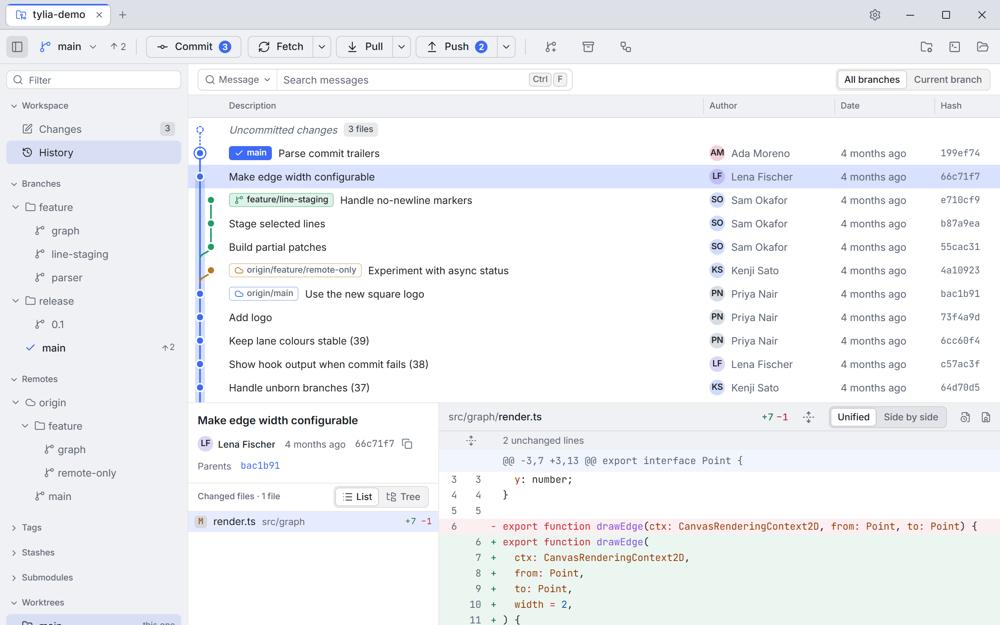
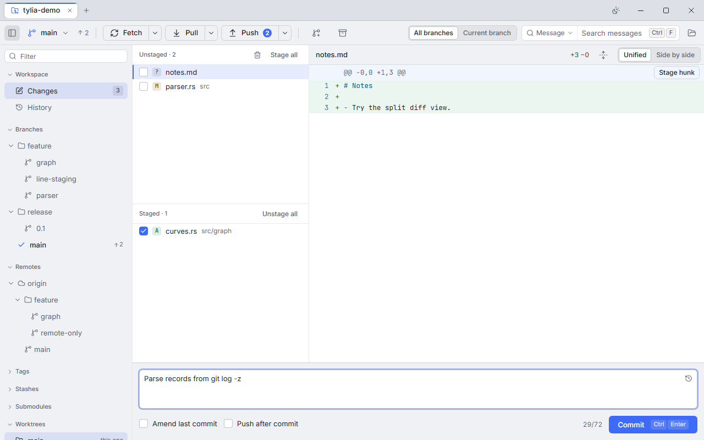

<p align="center">
  <picture>
    <source media="(prefers-color-scheme: dark)" srcset="docs/assets/wordmark-dark.png">
    
  </picture>
</p>

<p align="center">
  <strong>A calm, fast Git client for Linux, Windows and macOS.</strong><br>
  A beautiful commit graph, staging down to single lines, and zero clutter.
</p>

<p align="center">
  <a href="https://github.com/gilgil28/tylia/actions/workflows/ci.yml"></a>
  <a href="#license"></a>
  <a href="#platforms"></a>
  <a href="#privacy"></a>
</p>

<p align="center">
  <a href="#download"><b>Download</b></a> ·
  <a href="CHANGELOG.md"><b>Changelog</b></a> ·
  <a href="docs/ROADMAP.md"><b>Roadmap</b></a> ·
  <a href="CONTRIBUTING.md"><b>Contributing</b></a>
</p>

<picture>
  <source media="(prefers-color-scheme: dark)" srcset="docs/screenshots/history-dark.png">
  
</picture>

## Why Tylia

The Git client you would show someone to prove a GUI can be faster and clearer than the
command line. It uses the system `git`, so hooks, credential helpers, signing and your Git
config work exactly as they do on the command line.

Tylia is pronounced **TEE-lee-a**. The name is a respelling of _Tilia_, botanical Latin
for the linden tree.

## Features

- **A commit graph that stays fast** on very large repositories, with branch and tag
  labels, all or current branch, and search by message, author, hash or file.
- **Staging down to single lines:** stage, unstage or discard files, hunks or selected
  lines. Discarded new files go to the trash, not into oblivion.
- **Remotes:** fetch, pull and push with progress and cancel, and sign-in dialogs for
  HTTPS tokens and SSH keys.
- **Branching:** merge, rebase, cherry-pick, revert, reset, tags and stashes, with
  per-block conflict resolution.
- **Interactive rebase:** drag to reorder; pick, reword, edit, squash, fixup or drop.
- **Blame and file history** that follow renames.
- **A command palette** (Ctrl/Cmd+K) for every action, and rebindable shortcuts.
- **git-flow, submodules, worktrees** and Git LFS indicators.
- **Light and dark themes,** keyboard-first and screen-reader friendly.

<picture>
  <source media="(prefers-color-scheme: dark)" srcset="docs/screenshots/changes-dark.png">
  
</picture>

Tylia is young (0.x). See [`CHANGELOG.md`](CHANGELOG.md) for what's in each release and
[`docs/ROADMAP.md`](docs/ROADMAP.md) for the plan.

## Download

Get the latest version from the
[releases page](https://github.com/gilgil28/tylia/releases/latest):

- **Windows 10 and 11:** `Tylia_<version>_x64-setup.exe` (or the `.msi`).
- **macOS 12+:** `Tylia_<version>_universal.dmg` (Apple silicon and Intel).
- **Linux:** `.AppImage`, `.deb` or `.rpm`. On Arch and CachyOS, install
  [`tylia-bin`](https://aur.archlinux.org/packages/tylia-bin) from the AUR.

Tylia needs Git 2.40 or newer on your `PATH`. Builds are not code-signed yet:

- **Windows:** SmartScreen asks first. Choose **More info → Run anyway**.
- **macOS:** right-click the app and choose **Open** the first time.

See [docs/RELEASING.md](docs/RELEASING.md#code-signing-not-set-up-yet) for details.

## Principles

- **Calm by default.** Content first, chrome last. Colour is reserved for meaning.
- **The graph is the hero.** Legible at a glance and instant on huge repositories.
- **Keyboard-first, mouse-friendly.** Every action in a command palette and a shortcut.
- **Never lose work.** Destructive operations confirm and explain what will be lost.
- **Honest about Git.** Show the real command and the real error when something fails.
- **Fast.** Navigation feels instant; nothing blocks the UI.
- **Private.** No telemetry, no network requests you did not trigger.
- **Cross-platform, native-respectful.** One app on Linux, Windows and macOS that follows
  each platform's conventions.

Tylia is inspired by the workflow of Sourcetree; its design and code are its own.

## Platforms

| OS                                                    | Webview       | Notes                              |
| ----------------------------------------------------- | ------------- | ---------------------------------- |
| Linux (Arch/CachyOS first-class, also Ubuntu, Fedora) | WebKitGTK 4.1 | Performance is measured here first |
| Windows 10 and 11                                     | WebView2      |                                    |
| macOS 12+ (Apple silicon and Intel)                   | WKWebView     |                                    |

Packages: AppImage, deb, rpm and AUR on Linux; an NSIS installer and an MSI on Windows; a
universal dmg on macOS.

## Build from source

You need Rust stable (via rustup), Node.js 24 LTS, pnpm 12 and Git 2.40 or newer, plus:

- **Windows:** WebView2 runtime and the MSVC Build Tools with "Desktop development with C++".
- **macOS:** Xcode Command Line Tools.
- **Arch / CachyOS:** `webkit2gtk-4.1 base-devel curl wget file openssl appmenu-gtk-module libappindicator-gtk3 librsvg xdotool`
- **Debian / Ubuntu:** `libwebkit2gtk-4.1-dev build-essential curl wget file libxdo-dev libssl-dev libayatana-appindicator3-dev librsvg2-dev`

Exact install commands are in [CONTRIBUTING.md](CONTRIBUTING.md#prerequisites).

```sh
git clone https://github.com/gilgil28/tylia.git
cd tylia
pnpm install
pnpm tauri dev
```

Tests, linters and the other commands are listed in
[CONTRIBUTING.md](CONTRIBUTING.md#commands).

## Contributing

See [CONTRIBUTING.md](CONTRIBUTING.md) and the [code of conduct](CODE_OF_CONDUCT.md).
Report security issues privately as described in [SECURITY.md](SECURITY.md).

## Privacy

Tylia has no telemetry. It only goes on the network for Git operations you start, such as
fetch, pull, push and clone, and for features you opt into. The update check is off by
default; when you turn it on (or press "Check now"), Tylia downloads the latest release's
`latest.json` from GitHub and sends nothing else. Avatars are off by default.

## License

Licensed under either of [Apache License, Version 2.0](LICENSE-APACHE) or
[MIT license](LICENSE-MIT) at your option.

Unless you explicitly state otherwise, any contribution intentionally submitted for
inclusion in the work by you, as defined in the Apache-2.0 license, shall be dual licensed
as above, without any additional terms or conditions.
